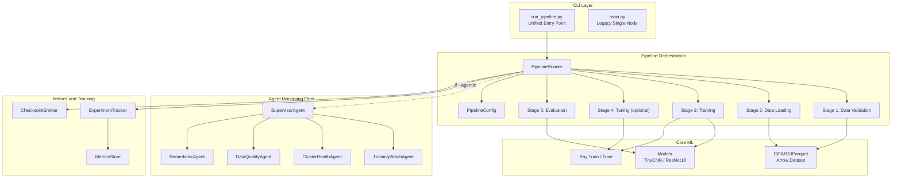
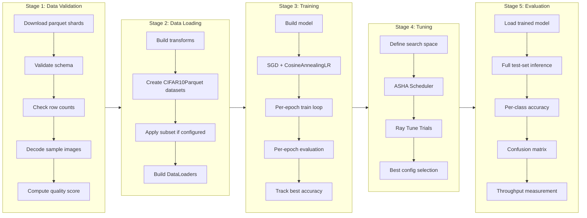
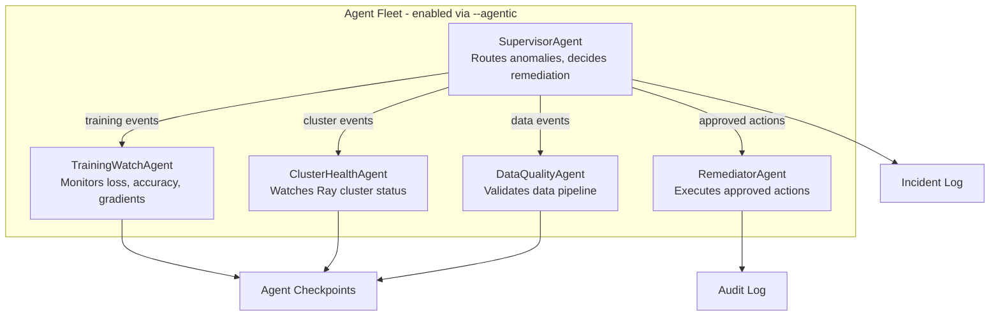
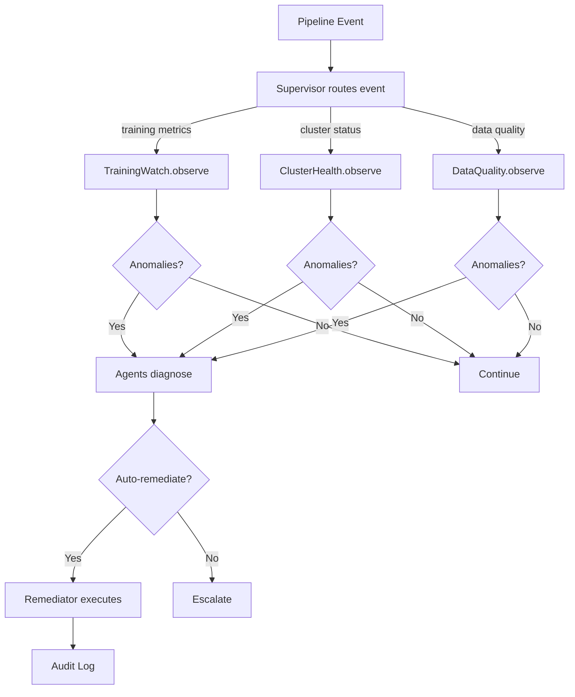
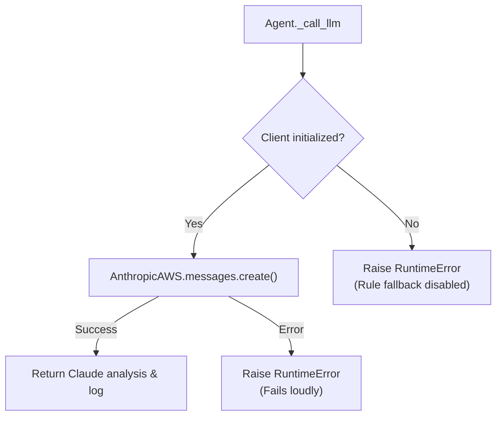
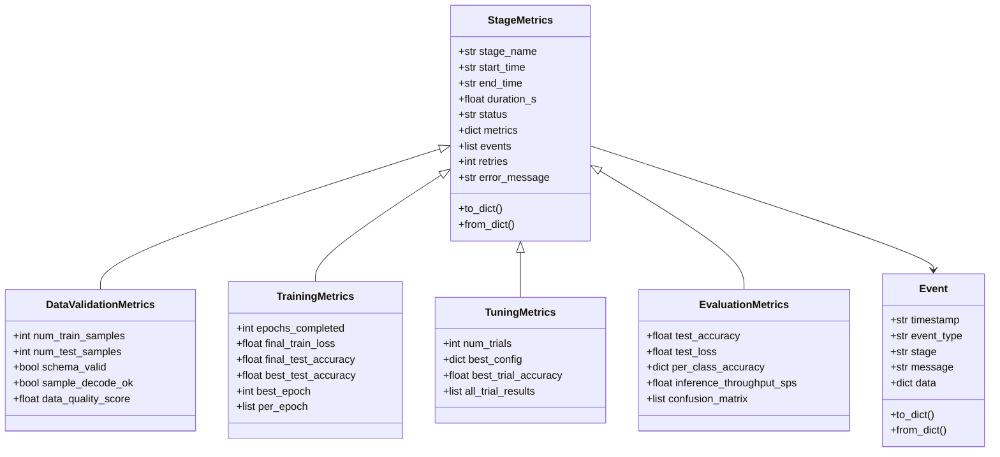
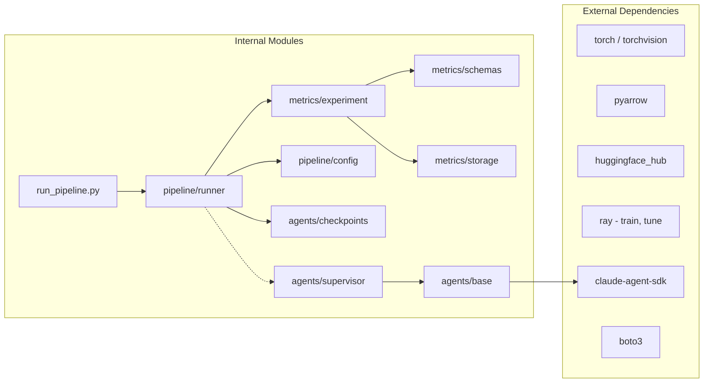
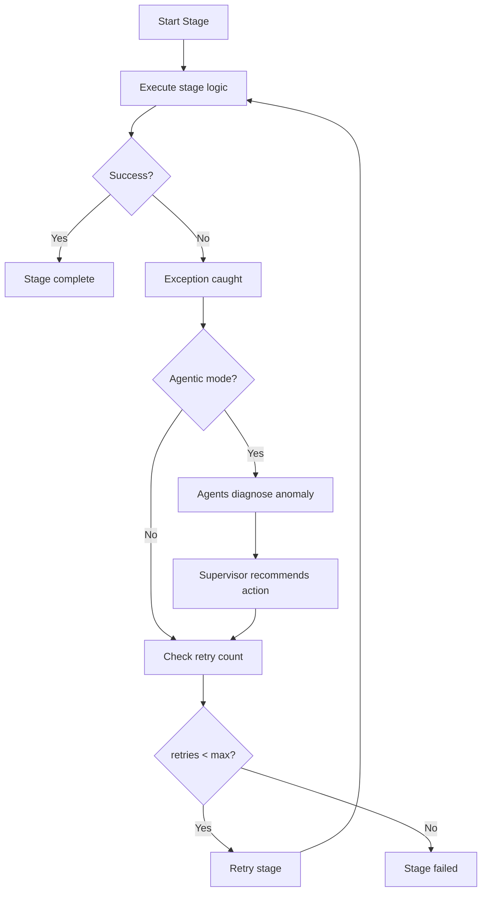

# AutoPARK: Autonomous Closed-Loop Self-Healing ML Platform — Architecture Specification

> Complete technical architecture specification of the **AutoPARK platform**, detailing the Split-Plane Model, modular actuation plugins, shared-RAM knob mutations, multi-tier progressive fault injection testbench, and deployment paths on Amazon EKS + KubeRay.

---

## 1. System Overview & The Split-Plane Model

AutoPARK implements a closed-loop, self-healing ML training architecture built on the **PARK stack** (PyTorch + Arrow + Ray + Kubernetes), supervised by a distributed fleet of cognitive agents powered by Claude on AWS (`claude-haiku-4-5-20251001` via `anthropic[aws]`).

### The Split-Plane Architecture
AutoPARK decouples execution into two operational planes:
1. **The Deterministic Execution Plane (In-Container)**: Ray workers, PyTorch training loops, and Apache Arrow data loaders run at full throughput in Kubernetes containers.
2. **The Cognitive Reasoning Plane (Cloud-Hosted)**: Claude on AWS inspects structured multi-factor telemetry across loss trajectories, gradient norms, batch sizes, and cluster events, synthesizing root causes and dispatching targeted interventions.

### Key Design Principles

| Principle | Implementation |
|---|---|
| **Active Actuation ("Agents with Hands")** | Replaces passive dashboards with modular plugins that mutate in-memory configs, restart workers, and isolate corrupt data partitions. |
| **Zero Cold-Boot Overhead** | Hyperparameter and resource ceiling mutations occur directly in shared RAM (`PipelineConfig`), avoiding multi-minute Kubernetes pod restarts. |
| **Split-Plane Decoupling** | High-throughput GPU/CPU loops never wait on LLM tokens unless an anomaly is intercepted. |
| **Strict Safety Boundaries** | Hardcoded `SAFE_REMEDIATIONS` gates ensure un-remediable structural or code bugs safely escalate to human engineers. |
| **A/B Benchmark Ablation** | Built-in comparative test harness executes identical workloads across unassisted baseline vs. AutoPARK modes. |
| **Local-to-Cloud Parity** | Runs seamlessly on local Apple Silicon / CPU and on Amazon EKS with Spot `c6i.xlarge` nodes. |

---

## 2. High-Level Architecture



---

## 3. Pipeline Stages — Detailed Data Flow



---

## 4. Agent Monitoring Architecture

### 4.1 Agent Fleet Hierarchy



### 4.2 Agent Decision Flow



### 4.3 Anomaly Detection Rules

| Agent | Anomaly | Detection Rule | Recommended Action |
|---|---|---|---|
| **TrainingWatch** | `nan_loss_detected` | `loss` is NaN or Inf | `retry_with_lower_lr` |
| **TrainingWatch** | `loss_plateau` | Loss unchanged for 5+ epochs | `adjust_learning_rate` |
| **TrainingWatch** | `accuracy_regression` | Accuracy drops > 5% from best | `investigate_data_pipeline` |
| **TrainingWatch** | `gradient_explosion` | Gradient norm > 100 | `enable_gradient_clipping` |
| **ClusterHealth** | `worker_shortage` | Worker count < expected | `restart_workers` |
| **ClusterHealth** | `task_failure` | Ray task failure detected | `retry_stage` |
| **ClusterHealth** | `memory_pressure` | Memory usage > 90% | `reduce_batch_size` |
| **DataQuality** | `schema_error` | Missing `img` or `label` column | `halt_pipeline` |
| **DataQuality** | `corrupt_data` | Image decode failure | `filter_corrupt_data` |

### 4.4 LLM Integration Path



**To activate agents**: Set `ANTHROPIC_AWS_API_KEY` and `ANTHROPIC_AWS_WORKSPACE_ID` in `.env` for Claude Platform on AWS. Rule-based fallbacks are strictly disabled.

---

## 5. Metrics System

### 5.1 Experiment Directory Structure

```
experiments/
├── latest -> run_20260816_041256_37c6
├── run_20260816_041235_74f8/             (non-agentic run)
│   ├── config.json
│   ├── data_validation_metrics.json
│   ├── data_loading_metrics.json
│   ├── training_metrics.json
│   ├── tuning_metrics.json
│   ├── evaluation_metrics.json
│   ├── experiment_summary.json
│   └── checkpoints/
├── run_20260816_041256_37c6/             (agentic run)
│   ├── config.json
│   ├── data_validation_metrics.json
│   ├── data_loading_metrics.json
│   ├── training_metrics.json
│   ├── tuning_metrics.json
│   ├── evaluation_metrics.json
│   ├── experiment_summary.json
│   ├── incidents.json
│   ├── action_log.json
│   └── checkpoints/
│       ├── data_validation_stage_start_*.json
│       ├── data_validation_stage_end_*.json
│       ├── training_stage_start_*.json
│       ├── training_epoch_boundary_*.json
│       ├── training_stage_end_*.json
│       ├── evaluation_stage_start_*.json
│       └── evaluation_stage_end_*.json
```

### 5.2 Metrics Schema Hierarchy



### 5.3 Key Metrics Per Stage

| Stage | Key Metrics | Tracked In |
|---|---|---|
| **Data Validation** | quality_score, schema_valid, sample_decode_ok, row counts | `data_validation_metrics.json` |
| **Data Loading** | train_samples, test_samples, load_time_s, batch_size | `data_loading_metrics.json` |
| **Training** | per-epoch loss/accuracy/LR/grad_norm, best_accuracy, training_time | `training_metrics.json` |
| **Tuning** | num_trials, best_config, best_trial_accuracy | `tuning_metrics.json` |
| **Evaluation** | test_accuracy, test_loss, per_class_accuracy, throughput, confusion_matrix | `evaluation_metrics.json` |

---

## 6. Component Reference

### 6.1 File Map

```
agentic-ml-infra/
├── run_pipeline.py              # Unified CLI entry point
├── main.py                      # Legacy single-node training
├── requirements.txt             # Python dependencies
│
├── pipeline/                    # Pipeline orchestration
│   ├── config.py                # PipelineConfig dataclass
│   ├── stages.py                # Stage enum + StageRunner base
│   ├── runner.py                # PipelineRunner orchestrator
│   ├── data_validation.py       # Stage 1
│   ├── data_loading.py          # Stage 2
│   ├── training.py              # Stage 3
│   ├── tuning.py                # Stage 4
│   └── evaluation.py            # Stage 5
│
├── agents/                      # Agentic monitoring layer
│   ├── base.py                  # AgentBase ABC with LLM stub
│   ├── checkpoints.py           # AgentCheckpoint + emitter
│   ├── supervisor.py            # Fleet orchestrator
│   ├── training_watch.py        # Loss/accuracy/gradient monitor
│   ├── cluster_health.py        # Ray cluster status monitor
│   ├── data_quality.py          # Data pipeline validator
│   └── remediator.py            # Gated action executor
│
├── metrics/                     # Experiment tracking
│   ├── schemas.py               # Metrics dataclasses
│   ├── experiment.py            # ExperimentTracker
│   └── storage.py               # MetricsStore
│
├── models/                      # Model definitions
│   ├── resnet.py                # CIFAR-adapted ResNet18
│   └── tiny_cnn.py              # ~40K param CNN
│
├── datasets/                    # Data loading
│   └── cifar10.py               # Arrow/parquet CIFAR-10 loader
│
├── aws/                         # Cloud infrastructure
│   ├── README.md                # Deployment guide
│   ├── eks-cluster.yaml         # EKS cluster config
│   ├── s3_config.py             # S3 data/metrics backend
│   ├── ecr_push.sh              # ECR image push script
│   └── iam_roles.yaml           # IAM roles (IRSA)
│
├── docker/                      # Container images
│   ├── Dockerfile.pytorch       # Base PyTorch image
│   ├── Dockerfile.cifar10       # Training application image
│   └── docker-compose.yml       # Local container orchestration
│
├── kubernetes/                  # K8s resources
│   └── park-cluster.yaml        # Namespace + ServiceAccount
│
└── ray/                         # Ray distributed training
    ├── cifar10-train.py          # Ray Train script
    └── ray-cluster.yaml          # KubeRay RayCluster CRD
```

### 6.2 Dependency Graph



---

## 7. Retry and Fast-Fail Logic

### 7.1 Stage Retry Flow



### 7.2 Training Anomaly Detection

| Check | When | Action |
|---|---|---|
| NaN/Inf loss | Every batch | Immediate exception, retry with lower LR |
| Gradient explosion | Every batch, norm > 1000 | Warning event + agent checkpoint |
| Accuracy regression | Every epoch, > 10% drop | Warning event + agent checkpoint |
| Loss plateau | Agent-side, 5+ epochs | Agent recommends LR adjustment |

---

## 8. Local to Cloud Deployment Path

```mermaid
flowchart LR
    subgraph Local["Stage 0: Local Dev"]
        L1["python run_pipeline.py"]
        L2["Single-node training"]
        L3["Agents as threads"]
    end

    subgraph K8s["Stage 1: Local KubeRay"]
        K1["kind/minikube cluster"]
        K2["ray-cluster.yaml"]
    end

    subgraph EKS["Stage 2: AWS EKS"]
        E1["eksctl create cluster"]
        E2["ECR images"]
        E3["S3 data + experiments"]
        E4["IAM IRSA roles"]
    end

    subgraph Prod["Stage 3: Production"]
        P1["Claude Platform on AWS"]
        P2["CloudWatch"]
        P3["Agents as K8s Jobs"]
    end

    Local --> K8s --> EKS --> Prod
```



### Environment Variables

| Variable | Local | Cloud | Purpose |
|---|---|---|---|
| `ANTHROPIC_AWS_API_KEY` | In `.env` | Secrets Manager | Claude Platform on AWS API key |
| `ANTHROPIC_AWS_WORKSPACE_ID` | In `.env` | Secrets Manager | Workspace ID for Claude Platform on AWS |
| `AWS_REGION` | `us-east-1` | `us-east-1` / `us-west-2` | AWS region |
| `ANTHROPIC_MODEL` | Optional | Optional | Model identifier (defaults to `claude-haiku-4-5-20251001`) |
| `AGENTIC_MODE` | `0` or `1` | `1` | Env var fallback for agent toggle |
| `HF_TOKEN` | Optional | Secrets Manager | HF authentication |

---

## 9. CLI Reference

```bash
# Quick smoke test
python run_pipeline.py --model tiny --epochs 2 --subset 500 --no-tune

# Full pipeline with agentic monitoring
python run_pipeline.py --model tiny --epochs 5 --agentic --no-tune

# Pipeline with hyperparameter tuning
python run_pipeline.py --model tiny --epochs 3 --tune --tune-samples 4

# Full ResNet18 training
python run_pipeline.py --model resnet18 --epochs 20

# Compare agentic vs non-agentic
python run_pipeline.py --model tiny --epochs 5 --subset 1000 --no-agentic
python run_pipeline.py --model tiny --epochs 5 --subset 1000 --agentic

# View results
cat experiments/latest/experiment_summary.json | python -m json.tool
ls experiments/latest/checkpoints/
```

### All Flags

| Flag | Default | Description |
|---|---|---|
| `--model {tiny,resnet18}` | `tiny` | Model architecture |
| `--epochs N` | `5` | Training epochs |
| `--batch-size N` | `128` | Training batch size |
| `--lr F` | `0.1` | Initial learning rate |
| `--device {cpu,mps,cuda}` | `cpu` | Compute device |
| `--agentic / --no-agentic` | off | Toggle agent monitoring |
| `--tune / --no-tune` | off | Toggle hyperparameter tuning |
| `--tune-samples N` | `4` | Number of Ray Tune trials |
| `--max-retries N` | `3` | Max auto-retries per stage |
| `--subset N` | None | Use only N data samples |
| `--run-id ID` | auto | Explicit experiment ID |

---

## 10. Value Proposition: Agentic vs Standard Mode

### What the agentic layer provides

1. **Saving wasted compute via intelligent retries**: When a training stage fails (NaN loss, OOM, gradient explosion), agents diagnose the root cause and recommend a targeted fix (lower LR, reduce batch size, enable gradient clipping) rather than blindly retrying with the same config.

2. **Reducing human intervention**: The agent fleet handles the most common failure modes automatically. The supervisor decides which anomalies are safe to auto-remediate vs which need human escalation. All actions are audit-logged.

### Measurable comparison points

| Metric | Standard Mode | Agentic Mode |
|---|---|---|
| Checkpoint files generated | 0 | ~10+ per run |
| Anomaly detection | Inline NaN/Inf only | 9+ detection rules across 3 agents |
| Retry intelligence | Same config | Modified config based on diagnosis |
| Incident logging | None | Full incident + audit trail |
| LLM-enhanced diagnosis | No | Yes (when API key configured) |
| Overhead | ~0% | ~2-5% (checkpoint I/O) |
