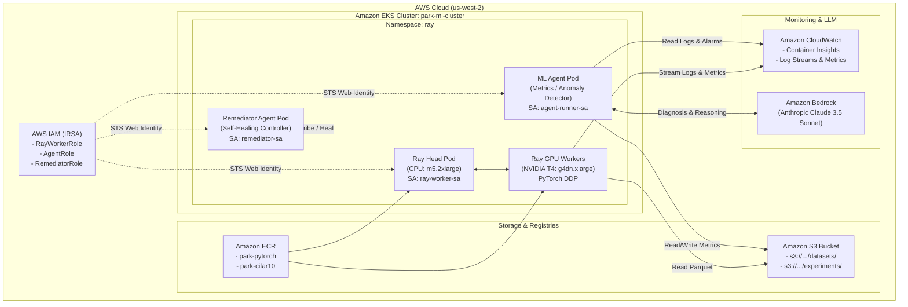

# AWS Cloud Infrastructure & Deployment Guide

This guide details the complete deployment workflow for running the **Agentic ML Training Platform** on Amazon Web Services (AWS). The infrastructure leverages **Amazon EKS** with GPU-accelerated node groups, **KubeRay** for distributed PyTorch training, **Amazon S3** for parquet datasets and experiment artifacts, **IAM Roles for Service Accounts (IRSA)** for least-privilege pod security, **Amazon CloudWatch** for observability, and **Amazon Bedrock / Claude 3.5 Sonnet** for autonomous agent monitoring and remediation.

---

## Architecture Overview



---

## Prerequisites & Tooling

Ensure the following tools are installed on your workstation:

| Tool | Minimum Version | Installation Check | Purpose |
|------|-----------------|--------------------|---------|
| [AWS CLI](https://aws.amazon.com/cli/) | `>= 2.15.0` | `aws --version` | AWS resource management & auth |
| [eksctl](https://eksctl.io/) | `>= 0.170.0` | `eksctl version` | EKS cluster lifecycle & node groups |
| [kubectl](https://kubernetes.io/docs/tasks/tools/) | `>= 1.29.0` | `kubectl version --client` | Kubernetes cluster management |
| [Helm](https://helm.sh/) | `>= 3.12.0` | `helm version` | KubeRay operator installation |
| [Docker](https://www.docker.com/) | `>= 24.0.0` | `docker version` | Building container images |

---

## Environment Variables

Configure your environment before executing the deployment steps:

```bash
# Target AWS Region and Account
export AWS_REGION="us-west-2"
export AWS_ACCOUNT_ID="$(aws sts get-caller-identity --query Account --output text)"

# Cluster and Storage Configuration
export CLUSTER_NAME="park-ml-cluster"
export S3_BUCKET_NAME="park-ml-experiments-${AWS_ACCOUNT_ID}-${AWS_REGION}"
export IMAGE_TAG="v1"

# LLM Provider Configuration (Choose Option A or Option B)
# Option A: Amazon Bedrock (Recommended for AWS deployments)
export CLAUDE_CODE_USE_BEDROCK=1
export AWS_BEDROCK_REGION="us-west-2"

# Option B: Direct Anthropic API
# export ANTHROPIC_API_KEY="sk-ant-api03-..."
```

Verify your active caller identity:
```bash
aws sts get-caller-identity
```

---

## Step 1: Create ECR Repositories and Push Images

The platform uses two container images:
1. `park-pytorch`: Base image containing PyTorch 2.3 CUDA runtime and python dependencies.
2. `park-cifar10`: Application image containing the training logic, pipeline stages, and agent monitoring platform.

Run the automated build and push script:

```bash
chmod +x aws/ecr_push.sh
./aws/ecr_push.sh --region "${AWS_REGION}" --tag "${IMAGE_TAG}"
```

This script will:
- Authenticate Docker with Amazon ECR.
- Create repositories `park-pytorch` and `park-cifar10` if they do not exist.
- Build both Dockerfiles in `docker/`.
- Tag and push images to `${AWS_ACCOUNT_ID}.dkr.ecr.${AWS_REGION}.amazonaws.com/`.

---

## Step 2: Create EKS Cluster with GPU Node Groups

Deploy the EKS cluster using `aws/eks-cluster.yaml`. This provisions:
- EKS Control Plane (Kubernetes 1.29) with IAM OIDC Provider enabled.
- `cpu-workers` node group: `m5.2xlarge` (2–8 nodes) for Ray head and agent pods.
- `gpu-workers` node group: `g4dn.xlarge` with NVIDIA T4 GPUs (0–4 nodes) for distributed training.
- CloudWatch control-plane log streams.

```bash
# Provision the cluster (takes ~15-20 minutes)
eksctl create cluster -f aws/eks-cluster.yaml

# Update local kubeconfig context
aws eks update-kubeconfig --region "${AWS_REGION}" --name "${CLUSTER_NAME}"

# Verify connected nodes
kubectl get nodes -L nvidia.com/gpu,role
```

Install the NVIDIA Kubernetes device plugin so GPU instances expose allocatable `nvidia.com/gpu` resources:

```bash
kubectl create -f https://raw.githubusercontent.com/NVIDIA/k8s-device-plugin/v0.15.0/deployments/static/gpu-feature-discovery-daemonset.yaml
kubectl create -f https://raw.githubusercontent.com/NVIDIA/k8s-device-plugin/v0.15.0/deployments/static/nvidia-device-plugin.yaml

# Verify GPU resource capacity on gpu-workers
kubectl get nodes -l nvidia.com/gpu=true -o custom-columns=NAME:.metadata.name,GPUS:.status.allocatable.'nvidia\.com/gpu'
```

---

## Step 3: Install KubeRay Operator via Helm

Install the official KubeRay Operator to manage `RayCluster` and `RayJob` custom resources:

```bash
# Add KubeRay Helm repository
helm repo add kuberay https://ray-project.github.io/kuberay-helm/
helm repo update

# Install KubeRay operator in dedicated namespace
helm install kuberay-operator kuberay/kuberay-operator \
    --version 1.1.0 \
    --namespace ray-system \
    --create-namespace

# Verify operator deployment
kubectl get pods -n ray-system
```

---

## Step 4: Configure S3 for Data and Experiment Storage

Create the dedicated S3 bucket with default server-side encryption (AES256) and block public access:

```bash
# Create S3 Bucket
aws s3api create-bucket \
    --bucket "${S3_BUCKET_NAME}" \
    --region "${AWS_REGION}" \
    --create-bucket-configuration LocationConstraint="${AWS_REGION}"

# Enable bucket encryption and enforce private access
aws s3api put-bucket-encryption \
    --bucket "${S3_BUCKET_NAME}" \
    --server-side-encryption-configuration '{"Rules":[{"ApplyServerSideEncryptionByDefault":{"SSEAlgorithm":"AES256"}}]}'

aws s3api put-public-access-block \
    --bucket "${S3_BUCKET_NAME}" \
    --public-access-block-configuration "BlockPublicAcls=true,IgnorePublicAcls=true,BlockPublicPolicy=true,RestrictPublicBuckets=true"
```

### Upload CIFAR-10 Dataset to S3

Upload local or downloaded parquet shards using Python and `aws/s3_config.py`:

```python
from pathlib import Path
from aws.s3_config import S3Config, upload_dataset
from datasets.cifar10 import download_split

s3_cfg = S3Config(bucket_name="your-bucket-name", region="us-west-2")

# Download local split then upload to S3
train_path = download_split("train", cache_dir=Path("data/cifar10"))
test_path = download_split("test", cache_dir=Path("data/cifar10"))

upload_dataset(s3_cfg, train_path, split="train")
upload_dataset(s3_cfg, test_path, split="test")
```

---

## Step 5: Set up IAM Roles (IRSA) for Agent Permissions

Configure IAM Roles for Service Accounts (IRSA) to grant fine-grained AWS permissions directly to Kubernetes pods without storing static credentials in containers.

### 1. Deploy CloudFormation Stack

Retrieve the cluster's OIDC Provider ARN:

```bash
OIDC_PROVIDER_ARN=$(aws eks describe-cluster \
    --name "${CLUSTER_NAME}" \
    --query "cluster.identity.oidc.issuer" \
    --output text | sed -e 's|https://||' -e "s|^|arn:aws:iam::${AWS_ACCOUNT_ID}:oidc-provider/|")

echo "OIDC Provider ARN: ${OIDC_PROVIDER_ARN}"
```

Deploy `aws/iam_roles.yaml`:

```bash
aws cloudformation deploy \
    --template-file aws/iam_roles.yaml \
    --stack-name "${CLUSTER_NAME}-iam-roles" \
    --capabilities CAPABILITY_NAMED_IAM \
    --parameter-overrides \
        OIDCProviderArn="${OIDC_PROVIDER_ARN}" \
        S3BucketName="${S3_BUCKET_NAME}" \
        Namespace="ray" \
        RayWorkerServiceAccount="ray-worker-sa" \
        AgentServiceAccount="agent-runner-sa" \
        RemediatorServiceAccount="remediator-sa" \
        EKSClusterName="${CLUSTER_NAME}"
```

### 2. Create and Annotate Kubernetes Service Accounts

Create the `ray` namespace and ServiceAccounts bound to the IAM roles:

```bash
kubectl apply -f kubernetes/park-cluster.yaml

RAY_WORKER_ROLE_ARN=$(aws cloudformation describe-stacks \
    --stack-name "${CLUSTER_NAME}-iam-roles" \
    --query "Stacks[0].Outputs[?OutputKey=='RayWorkerRoleArn'].OutputValue" --output text)

AGENT_ROLE_ARN=$(aws cloudformation describe-stacks \
    --stack-name "${CLUSTER_NAME}-iam-roles" \
    --query "Stacks[0].Outputs[?OutputKey=='AgentRoleArn'].OutputValue" --output text)

REMEDIATOR_ROLE_ARN=$(aws cloudformation describe-stacks \
    --stack-name "${CLUSTER_NAME}-iam-roles" \
    --query "Stacks[0].Outputs[?OutputKey=='RemediatorRoleArn'].OutputValue" --output text)

# Annotate ServiceAccounts for IRSA
kubectl create serviceaccount ray-worker-sa -n ray --dry-run=client -o yaml | \
    kubectl annotate --local -f - eks.amazonaws.com/role-arn="${RAY_WORKER_ROLE_ARN}" -o yaml | \
    kubectl apply -f -

kubectl create serviceaccount agent-runner-sa -n ray --dry-run=client -o yaml | \
    kubectl annotate --local -f - eks.amazonaws.com/role-arn="${AGENT_ROLE_ARN}" -o yaml | \
    kubectl apply -f -

kubectl create serviceaccount remediator-sa -n ray --dry-run=client -o yaml | \
    kubectl annotate --local -f - eks.amazonaws.com/role-arn="${REMEDIATOR_ROLE_ARN}" -o yaml | \
    kubectl apply -f -
```

---

## Step 6: Deploy Ray Cluster with Custom Images

Deploy the Ray cluster configured to use the ECR image and the `ray-worker-sa` ServiceAccount:

```yaml
# Save as aws/ray-cluster-aws.yaml
apiVersion: ray.io/v1
kind: RayCluster
metadata:
  name: park-cluster
  namespace: ray
spec:
  rayVersion: "2.10.0"
  headGroupSpec:
    serviceAccountName: ray-worker-sa
    rayStartParams:
      dashboard-host: "0.0.0.0"
    template:
      spec:
        nodeSelector:
          role: cpu-worker
        containers:
          - name: ray-head
            image: <AWS_ACCOUNT_ID>.dkr.ecr.<AWS_REGION>.amazonaws.com/park-cifar10:v1
            imagePullPolicy: IfNotPresent
            env:
              - name: AWS_REGION
                value: "us-west-2"
              - name: S3_BUCKET_NAME
                value: "<S3_BUCKET_NAME>"
            ports:
              - containerPort: 6379
                name: gcs
              - containerPort: 8265
                name: dashboard
              - containerPort: 10001
                name: client
            resources:
              limits:
                cpu: "2"
                memory: "4Gi"
              requests:
                cpu: "1"
                memory: "2Gi"
  workerGroupSpecs:
    - groupName: gpu-trainers
      replicas: 1
      minReplicas: 0
      maxReplicas: 4
      serviceAccountName: ray-worker-sa
      rayStartParams: {}
      template:
        spec:
          nodeSelector:
            nvidia.com/gpu: "true"
          containers:
            - name: ray-worker
              image: <AWS_ACCOUNT_ID>.dkr.ecr.<AWS_REGION>.amazonaws.com/park-cifar10:v1
              imagePullPolicy: IfNotPresent
              env:
                - name: AWS_REGION
                  value: "us-west-2"
                - name: S3_BUCKET_NAME
                  value: "<S3_BUCKET_NAME>"
              resources:
                limits:
                  nvidia.com/gpu: 1
                  cpu: "3"
                  memory: "12Gi"
                requests:
                  nvidia.com/gpu: 1
                  cpu: "2"
                  memory: "8Gi"
```

Apply the Ray cluster manifest:
```bash
sed -e "s|<AWS_ACCOUNT_ID>|${AWS_ACCOUNT_ID}|g" \
    -e "s|<AWS_REGION>|${AWS_REGION}|g" \
    -e "s|<S3_BUCKET_NAME>|${S3_BUCKET_NAME}|g" \
    aws/ray-cluster-aws.yaml | kubectl apply -f -

# Monitor Ray pod status
kubectl get pods -n ray -w
```

Forward the Ray Dashboard to view real-time GPU metrics and actor topology:
```bash
kubectl port-forward svc/park-cluster-head-svc 8265:8265 -n ray
# Open http://localhost:8265 in browser
```

---

## Step 7: Deploy Training Job with Agent Monitoring

Submit a distributed training job to the Ray cluster using the Ray CLI or Kubernetes Job:

```bash
# Exec into Ray Head pod or run from local client via port-forward
kubectl exec -it deployment/park-cluster-head --namespace ray -- \
    python3 ray/cifar10-train.py \
        --epochs 20 \
        --batch-size 128 \
        --lr 0.1 \
        --num-workers 1 \
        --use-gpu \
        --address auto
```

### Running the Monitoring & Remediation Agent

Launch the autonomous monitoring agent pod configured with `agent-runner-sa`:

```yaml
# Save as aws/agent-pod.yaml
apiVersion: v1
kind: Pod
metadata:
  name: ml-agent-monitor
  namespace: ray
spec:
  serviceAccountName: agent-runner-sa
  restartPolicy: OnFailure
  containers:
    - name: agent
      image: <AWS_ACCOUNT_ID>.dkr.ecr.<AWS_REGION>.amazonaws.com/park-cifar10:v1
      env:
        - name: AWS_REGION
          value: "us-west-2"
        - name: S3_BUCKET_NAME
          value: "<S3_BUCKET_NAME>"
        - name: CLAUDE_CODE_USE_BEDROCK
          value: "1"
        - name: AWS_BEDROCK_REGION
          value: "us-west-2"
      command: ["python3", "-c"]
      args:
        - |
          import os
          from aws.s3_config import S3Config, S3MetricsStore
          cfg = S3Config(bucket_name=os.environ['S3_BUCKET_NAME'], region=os.environ['AWS_REGION'])
          store = S3MetricsStore(cfg)
          print("Active experiments in S3:", store.list_experiments())
          latest = store.get_latest()
          print("Latest run summary:", latest)
```

---

## Step 8: Configure CloudWatch for Observability

### 1. Install AWS CloudWatch Container Insights (Fluent Bit)

Deploy Container Insights to capture all container logs, cluster metrics, and crash events:

```bash
FluentBitHttpPort='2020'
FluentBitReadFromHead='Off'
FluentBitReadFromTail='On'

curl -s https://raw.githubusercontent.com/aws-samples/amazon-cloudwatch-container-insights/latest/k8s-deployment-manifest-templates/deployment-mode/daemonset/container-insights-monitoring/quickstart/cwagent-fluent-bit-quickstart.yaml | \
    sed -e "s/{{cluster_name}}/${CLUSTER_NAME}/g" \
        -e "s/{{region_name}}/${AWS_REGION}/g" \
        -e "s/{{http_port}}/${FluentBitHttpPort}/g" \
        -e "s/{{read_head}}/${FluentBitReadFromHead}/g" \
        -e "s/{{read_tail}}/${FluentBitReadFromTail}/g" | \
    kubectl apply -f -
```

### 2. View CloudWatch Log Groups

CloudWatch will receive log streams under:
- `/aws/containerinsights/park-ml-cluster/application` (Ray & Agent application logs)
- `/aws/containerinsights/park-ml-cluster/dataplane` (Kubelet & Docker/Containerd runtime)
- `/aws/eks/park-ml-cluster/cluster` (Control Plane API & Scheduler logs)

---

## Troubleshooting & Verification

### 1. Verify IRSA Web Identity Projection
```bash
kubectl exec -it -n ray $(kubectl get pods -n ray -l ray.io/node-type=head -o jsonpath='{.items[0].metadata.name}') -- aws sts get-caller-identity
```
*Expected output: Assumed role ARN matching `arn:aws:sts::<ACCOUNT_ID>:assumed-role/park-ml-cluster-RayWorkerRole/...`.*

### 2. GPU Node Quota & Allocation
If `gpu-workers` fail to scale up:
```bash
# Check EKS managed nodegroup scaling activity
aws eks describe-nodegroup --cluster-name park-ml-cluster --nodegroup-name gpu-workers

# Verify Service Quotas for Running On-Demand G and VT instances
aws service-quotas get-service-quota \
    --service-code ec2 \
    --quota-code L-DB2E16CF \
    --region us-west-2
```

### 3. Verify S3 Metrics Storage from Python
```python
from aws.s3_config import S3Config, S3MetricsStore

config = S3Config(bucket_name="park-ml-experiments-ACCOUNT-REGION")
store = S3MetricsStore(config)
print("Experiment Runs:", store.list_experiments())
```

---

## Teardown & Resource Cleanup

To avoid ongoing AWS charges after running experiments, clean up resources in reverse order:

```bash
# 1. Delete Ray Cluster and Agent pods
kubectl delete raycluster park-cluster -n ray
kubectl delete namespace ray

# 2. Delete CloudFormation IAM stack
aws cloudformation delete-stack --stack-name "${CLUSTER_NAME}-iam-roles"

# 3. Empty and delete S3 Bucket
aws s3 rm "s3://${S3_BUCKET_NAME}" --recursive
aws s3api delete-bucket --bucket "${S3_BUCKET_NAME}" --region "${AWS_REGION}"

# 4. Delete EKS Cluster (deletes VPC, security groups, and nodegroups)
eksctl delete cluster -f aws/eks-cluster.yaml

# 5. Delete ECR Repositories (optional)
aws ecr delete-repository --repository-name park-cifar10 --force --region "${AWS_REGION}"
aws ecr delete-repository --repository-name park-pytorch --force --region "${AWS_REGION}"
```
